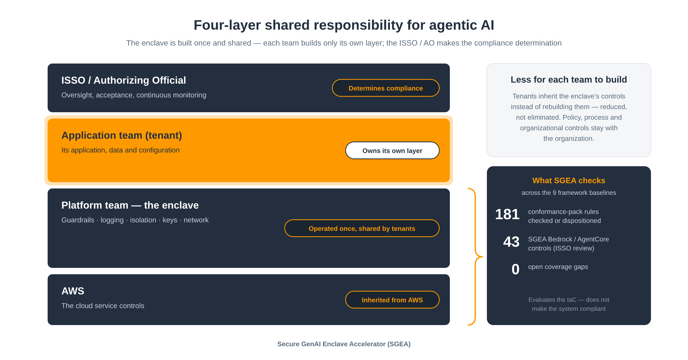

<!-- Generated by tools/framework_docs.py from catalog/, profiles/ and sources/inferred/ — do not edit. -->

# Frameworks

One page per SGEA baseline: conformance packs, profiles and validation status, control coverage, customer responsibilities, evidence and operations. Generated by `tools/framework_docs.py`; the rule-by-rule list is [docs/CONTROL-COVERAGE.md](../CONTROL-COVERAGE.md).

| Baseline | Framework | Packs | Profiles (composed) | Validation | Rules | Checked | Customer-prerequisite | Process | Open findings |
|---|---|---|---|---|---:|---:|---:|---:|---:|
| [dod-il2](dod-il2.md) | DoD SRG Impact Level 2 | CMMC-2.0-Level-2 | `dod-il2.commercial` | Sandbox-validated (Terraform, CDK); baseline flagged scaffold-unverified (`sgea export` needs `--allow-unverified`) | 130 | 53 | 18 | 2 | 0 |
| [dod-il4](dod-il4.md) | DoD SRG Impact Level 4 | NIST-800-53-rev-5, CMMC-2.0-Level-2 | `dod-il4.govcloud` | Not deployment-validated (`sgea verify` / `sgea check` only); baseline flagged scaffold-unverified (`sgea export` needs `--allow-unverified`) | 151 | 61 | 18 | 2 | 0 |
| [dod-il5](dod-il5.md) | DoD SRG Impact Level 5 | FedRAMP-HighPart1, FedRAMP-HighPart2, CMMC-2.0-Level-2 | `dod-il5.govcloud` | Not deployment-validated (`sgea verify` / `sgea check` only); baseline flagged scaffold-unverified (`sgea export` needs `--allow-unverified`) | 163 | 72 | 18 | 2 | 1 |
| [fda-21-cfr-part-11](fda-21-cfr-part-11.md) | FDA 21 CFR Part 11 | FDA-21CFR-Part-11 | `fedramp-moderate-part11.commercial` | Sandbox-validated (Terraform, CDK) | 129 | 57 | 17 | 0 | 0 |
| [fedramp-high](fedramp-high.md) | FedRAMP High | FedRAMP-HighPart1, FedRAMP-HighPart2 | `fedramp-high.govcloud` | Not deployment-validated (`sgea verify` / `sgea check` only); baseline flagged scaffold-unverified (`sgea export` needs `--allow-unverified`) | 145 | 69 | 14 | 0 | 1 |
| [fedramp-low](fedramp-low.md) | FedRAMP Low | FedRAMP-Low | `fedramp-low.commercial` | Sandbox-validated (Terraform, CDK) | 117 | 49 | 16 | 0 | 1 |
| [fedramp-moderate](fedramp-moderate.md) | FedRAMP Moderate | FedRAMP-Moderate | `dod-il2.commercial`, `fedramp-moderate-hipaa.commercial`, `fedramp-moderate-hitrust.commercial`, `fedramp-moderate-part11.commercial` | Sandbox-validated (Terraform, CDK) | 129 | 54 | 16 | 0 | 1 |
| [hipaa](hipaa.md) | HIPAA Security Rule | HIPAA-Security | `fedramp-moderate-hipaa.commercial`, `fedramp-moderate-hitrust.commercial` | Sandbox-validated (Terraform, CDK) | 130 | 55 | 15 | 1 | 0 |
| [hitrust](hitrust.md) | HITRUST CSF | NIST-800-53-rev-5 | `fedramp-moderate-hitrust.commercial` | Sandbox-validated (Terraform, CDK) | 130 | 52 | 15 | 0 | 0 |

Status meanings:

- `checked`: Enclave-implemented, checked by `sgea check` (Terraform plan and CDK template)
- `implement`: Enclave-owned, not yet emitted (open gap)
- `tenant`: Tenant app (service allowed for tenants; the enclave creates none)
- `not-in-enclave`: Service neither deployed nor allowed (SCP-denied; vacuously compliant)
- `customer-prerequisite`: Customer prerequisite (landing zone, identity, VPC)
- `process`: Process (manual evidence, e.g. Audit Manager)
- `runtime-only`: Runtime-only (observable on the live account; AWS Config evaluates it)
