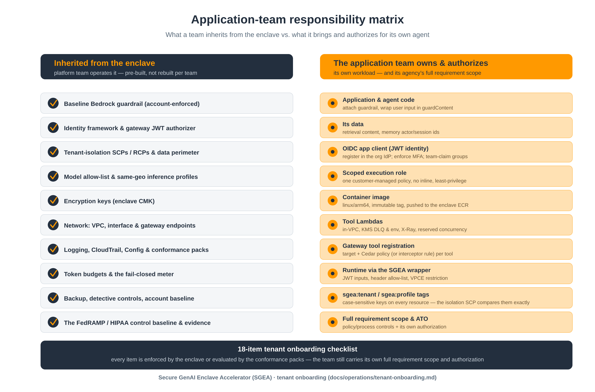

# Tenant application requirements

What an application team's agent must do to run in an SGEA enclave, how each requirement is verified, and the code for it in Python, Node.js (TypeScript), .NET (C#) and Java. The step-by-step procedure is [tenant onboarding](tenant-onboarding.md); this page is the contract you build and review against.

> **Sample code.** The snippets show the required calls; they are compiled in CI but are not a complete application. The full, sandbox-validated reference agent is [`examples/sample-agent`](../../examples/sample-agent/) (Python). Test your agent in a non-production account before use.



## How requirements are verified

| Tag | Meaning |
|---|---|
| **Enclave** | Enforced by the enclave itself (SCP, account-enforced guardrail, gateway default-deny, runtime authorizer); a violation fails at run time |
| **Config** | Evaluated by an AWS Config conformance-pack rule on your resources after deploy |
| **E2E** | Covered by one of the 9 end-to-end checks (`examples/sample-agent/scripts/e2e_test.py`, adapted to your agent) |
| **Review** | Not detectable automatically; check in code review against this page |

## Requirements

| ID | Level | Requirement | Verified by |
|---|---|---|---|
| TR-01 | MUST | Authenticate every caller with your organization's identity provider through the runtime JWT authorizer (OIDC app client, MFA enforced in the IdP); no anonymous invocation | Enclave, E2E (unauthenticated call rejected) |
| TR-02 | MUST | Take the caller's identity from the validated JWT (`sub`, team claim) — never from the request body | Review |
| TR-03 | MUST | Use a dedicated execution role: trust `bedrock-agentcore.amazonaws.com` with `aws:SourceAccount` / `aws:SourceArn`, one customer-managed policy scoped to your resources, no inline policies, no `*:*` or `<service>:*` actions, no KMS actions on all keys | Config (`iam-no-inline-policy-check`, admin-access rules), Review |
| TR-04 | MUST | Call models through Bedrock `Converse` with the enclave guardrail (`SGEA_GUARDRAIL_ID` / `SGEA_GUARDRAIL_VERSION`) on every call; you may add your own guardrails, never replace the baseline | Enclave (account-enforced guardrail), E2E (PII blocked) |
| TR-05 | MUST | Wrap user input in a `guardContent` block, so the guardrail evaluates exactly the user's text (the system prompt and tool results are not scanned as user input) | E2E, Review |
| TR-06 | MUST | Use only model IDs on the enclave's authorized list (`authorized_model_ids`), through an inference profile in the approved geography | Enclave (model allow-list SCP), Review |
| TR-07 | MUST | Send `requestMetadata` `sgea_user` / `sgea_team` on every `Converse` call; the enclave token meter credits per-user and per-team budgets from the invocation logs | E2E (usage credited) |
| TR-08 | MUST | Handle a guardrail intervention (`stopReason = guardrail_intervened`): return the enclave's blocked message, do not rephrase and retry to get around it, log the outcome only | E2E, Review |
| TR-09 | MUST | Reach tools only through the enclave AgentCore Gateway (MCP); never call a tool Lambda or backend directly | Enclave (gateway default-deny), Review |
| TR-10 | MUST | Identify the caller on gateway calls: `X-Sgea-User` / `X-Sgea-Team` headers with a SigV4-signed request (AWS_IAM gateway), or the caller's bearer token (CUSTOM_JWT gateway); with token control on, an unidentified tool call is denied | Enclave, E2E (over-budget tool calls denied) |
| TR-11 | MUST | Register each tool as a gateway target and permit it with one Cedar policy per tool whose principal is exactly your agent role (in GovCloud, an interceptor rule through an enclave change) | Enclave (default-deny), E2E (tool call allowed) |
| TR-12 | MUST | Handle a denied tool call (JSON-RPC `error`): return it to the model as a failed tool result or tell the user; do not route around the gateway | Review |
| TR-13 | MUST | Tool Lambdas: in the agent subnets, KMS-encrypted dead-letter queue and environment, X-Ray active, reserved concurrency (see SGEA-KF-02), log retention and KMS, no inline policies | Config (`lambda-inside-vpc`, `lambda-dlq-check`, `lambda-concurrency-check`, log-group rules, `iam-no-inline-policy-check`) |
| TR-14 | MUST | Deploy the runtime with SGEA's `agentcore-runtime` wrapper: `request_header_allowlist = ["Authorization"]`, `allowed_source_vpce_ids` set to the enclave's AgentCore endpoint(s) | Review (SGEA-AC-ID-04 unmet when the endpoint ids are empty) |
| TR-15 | MUST | Container: `linux/arm64`, serves `GET /ping` and `POST /invocations` on port 8080, pushed to the enclave repository with an immutable, content-derived tag; base image from a registry your organization trusts (for example through an ECR pull-through cache) | Enclave (ECR immutable tags, scan on push), E2E |
| TR-16 | MUST | Apply the enclave CMK and the pack retention to the runtime's log group right after the runtime exists | Config (`cloudwatch-log-group-encrypted`, `cw-loggroup-retention-period-check`) |
| TR-17 | MUST | Never log prompts, answers, tool arguments, tokens or JWTs; log outcomes (status, stop reason, blocked / denied, sizes) only | Review |
| TR-18 | MUST | Use enclave memory with your own `actorId` / `sessionId` scheme; memory is shared and untagged, so separation from other tenants rests on your ids and IAM scoping | Review |
| TR-19 | MUST | Tag every resource and role `sgea:tenant = <tenant>` and `sgea:profile = <profile-id>` (exact, lowercase keys — the tenant-isolation SCP compares them) | Review (tag report) |
| TR-20 | MUST | Pass the 9 end-to-end checks in non-production, and add no new NON_COMPLIANT tenant resources beyond accepted deviations in the conformance packs | E2E, Config |
| TR-21 | SHOULD | Retry throttled calls (`ThrottlingException`, HTTP 429) with exponential backoff and jitter; do not retry guardrail or policy denials | Review |
| TR-22 | SHOULD | Tell the user clearly when their token budget is exhausted (tool calls denied with a token-budget reason) instead of failing silently | Review |
| TR-23 | MUST | Instrument the agent with OpenTelemetry through AWS Distro for OpenTelemetry (ADOT) auto-instrumentation (startup line per language below), with `service.name` set to your agent; do not use the AWS X-Ray SDKs, which are in maintenance mode with end of support before February 25, 2027 | Review (spans visible in CloudWatch Transaction Search / GenAI observability) |
| TR-24 | MUST | Keep prompt and response content out of spans: leave generative-AI message-content capture off (`OTEL_INSTRUMENTATION_GENAI_CAPTURE_MESSAGE_CONTENT=false`) and add no prompt, answer, argument or token attributes to custom spans (TR-17 applies to traces too) | Review |
| TR-25 | SHOULD | Propagate trace context on outbound calls, including gateway calls (ADOT's HTTP instrumentation adds the `traceparent` / `X-Amzn-Trace-Id` headers; add them yourself if you instrument manually), so a request can be followed from the runtime through the gateway to the tool Lambda | Review |
| TR-26 | MUST | Tag each runtime execution role `sgea:team` = the one team whose users it serves (the value your JWT team claim carries), and do not detach the enclave policy `sgea-<env>-token-budget-exhausted` yourself: once that team reaches its monthly token budget, the enclave breaker (ADR 0003) attaches it and the role's model calls are denied until month rollover or a raised budget. A role shared by several teams cannot be tagged and is bounded only by the gateway (tool calls). Exclude the enclave's attachment from exclusive policy management in your IaC (for example `aws_iam_role_policy_attachments_exclusive`), or your next apply lifts the denial until the next heartbeat re-attaches it | Enclave (breaker), E2E (over-budget team denied, then released) |

## Interface: what the enclave gives your agent

Runtime environment variables (set through the `agentcore-runtime` wrapper's `environment`):

| Variable | Value | Used by |
|---|---|---|
| `SGEA_MODEL_ID` | Inference profile ID; its foundation model must be in `authorized_model_ids` | TR-04, TR-06 |
| `SGEA_GUARDRAIL_ID`, `SGEA_GUARDRAIL_VERSION` | Enclave output `guardrail_id`, `guardrail_version` | TR-04 |
| `SGEA_GATEWAY_URL` | Enclave output `gateway_url` | TR-09, TR-10 |
| `SGEA_MEMORY_ID` | Enclave output `memory_id` | TR-18 |
| `AWS_REGION` | Set by AgentCore Runtime | all |

Enclave outputs for your infrastructure (Terraform `terraform output -json enclave`; the reference tenant reads them in `examples/sample-agent/infra`):

| Output | Use |
|---|---|
| `kms_key_arn` | Encrypt your DLQs, Lambda environment and log groups (TR-13, TR-16) |
| `log_retention_days` | Log-group retention (TR-13, TR-16) |
| `agents_repository_url` | Where to push your image (TR-15) |
| `gateway_id`, `gateway_arn`, `gateway_url`, `gateway_role_name` | Gateway targets, Cedar policies and the gateway's invoke permission on your Lambdas (TR-09–TR-11) |
| `policy_engine_id` | Cedar policy engine; `null` in GovCloud (interceptor rules instead) (TR-11) |
| `memory_id` | Memory (TR-18) |
| `guardrail_id`, `guardrail_version`, `authorized_model_ids` | Model and guardrail (TR-04, TR-06) |
| `env`, `profile`, `region` | Naming and the `sgea:profile` tag (TR-19) |
| `token_per_user_daily`, `token_per_team_monthly`, `token_budget_exhausted_policy_arn` | Budgets your users and team are held to; the deny policy the breaker attaches to your `sgea:team`-tagged role (TR-07, TR-26) |
| VPC endpoint ids | Not in the root `enclave` output: take the `bedrock-agentcore` endpoint id(s) from the `enclave-network` module output `endpoint_ids` (TR-14) |

## Code

All four languages implement the same five functions (`examples/tenant-snippets/`): read the caller from the JWT, call the model with the guardrail, call a gateway tool, record the turn in memory, and log outcomes. Each folder builds with its standard tool, and CI builds all four.

| Language | Source | Build | Notes |
|---|---|---|---|
| Python | `python/sgea_tenant.py` | `python3 -m py_compile`, `pytest` | boto3; SigV4 with `botocore.auth.SigV4Auth` |
| Node.js (TypeScript) | `node/src/sgeaTenant.ts` | `npm ci && npm run build` | AWS SDK for JavaScript v3; SigV4 with `@smithy/signature-v4` |
| .NET (C#) | `dotnet/SgeaTenant.cs` | `dotnet build -c Release` | AWS SDK for .NET v4; SigV4 with the public `Amazon.Runtime.Signing.SigV4SigningHandler` (not `Amazon.Runtime.Internal.*`); v4 collections default to `null`, so initialise them |
| Java | `java/src/main/java/com/example/sgea/SgeaTenant.java` | `mvn -B compile` | AWS SDK for Java v2; SigV4 with `AwsV4HttpSigner` (not the deprecated `Aws4Signer`) |

### Caller identity from the JWT (TR-02)

<!-- sgea:snippet-block caller -->
<details open>
<summary>Python — <code>python/sgea_tenant.py</code></summary>

```python
def caller_from_jwt(authorization_header, team_claim="cognito:groups"):
    """(user, team) from the caller's JWT, or (None, None) on any decode error.

    The signature is NOT verified here: the AgentCore Runtime JWT authorizer has already
    validated the token. The header reaches the container because the runtime's
    request_header_allowlist includes "Authorization".
    """
    try:
        segment = authorization_header.split()[-1].split(".")[1]
        claims = json.loads(base64.urlsafe_b64decode(segment + "=" * (-len(segment) % 4)))
        user = claims.get("sub")
        value = claims.get(team_claim)
    except Exception:
        return None, None
    if isinstance(value, list):
        team = value[0] if value else None
    elif isinstance(value, str):
        team = value
    else:
        team = None
    return user, team
```

</details>

<details>
<summary>Node.js (TypeScript) — <code>node/src/sgeaTenant.ts</code></summary>

```typescript
export function callerFromJwt(
  authorizationHeader: string | undefined,
  teamClaim = "cognito:groups",
): [string | null, string | null] {
  // The signature is NOT verified here: the AgentCore Runtime JWT authorizer has already validated
  // the token (the header reaches the container because request_header_allowlist includes "Authorization").
  try {
    const token = (authorizationHeader ?? "").trim().split(/\s+/).pop() ?? "";
    const segment = token.split(".")[1];
    if (!segment) return [null, null];
    const claims = JSON.parse(Buffer.from(segment, "base64url").toString("utf8")) as Record<string, unknown>;
    const user = typeof claims.sub === "string" ? claims.sub : null;
    const raw = claims[teamClaim];
    let team: string | null = null;
    if (Array.isArray(raw)) team = raw.length > 0 ? String(raw[0]) : null;
    else if (typeof raw === "string") team = raw;
    return [user, team];
  } catch {
    return [null, null];
  }
}
```

</details>

<details>
<summary>.NET (C#) — <code>dotnet/SgeaTenant.cs</code></summary>

```csharp
/// <summary>(user, team) from the caller's JWT. Signature is NOT verified here: the AgentCore Runtime
/// JWT authorizer has already validated it (the header reaches the container because the runtime's
/// request_header_allowlist includes "Authorization").</summary>
public static (string? User, string? Team) CallerFromJwt(string? authorizationHeader, string teamClaim = "cognito:groups")
{
    try
    {
        var seg = authorizationHeader!.Split(' ', StringSplitOptions.RemoveEmptyEntries)[^1].Split('.')[1];
        var b64 = seg.Replace('-', '+').Replace('_', '/');
        b64 = b64.PadRight(b64.Length + (4 - b64.Length % 4) % 4, '=');
        using var doc = JsonDocument.Parse(Convert.FromBase64String(b64));
        var root = doc.RootElement;
        string? user = root.TryGetProperty("sub", out var sub) && sub.ValueKind == JsonValueKind.String ? sub.GetString() : null;
        string? team = null;
        if (root.TryGetProperty(teamClaim, out var t))
        {
            if (t.ValueKind == JsonValueKind.Array && t.GetArrayLength() > 0 && t[0].ValueKind == JsonValueKind.String)
                team = t[0].GetString();
            else if (t.ValueKind == JsonValueKind.String)
                team = t.GetString();
        }
        return (user, team);
    }
    catch (Exception)
    {
        return (null, null);
    }
}
```

</details>

<details>
<summary>Java — <code>java/src/main/java/com/example/sgea/SgeaTenant.java</code></summary>

```java
public record Caller(String user, String team) { }

/**
 * (user, team) from the caller's JWT. The signature is NOT verified here: the AgentCore Runtime
 * JWT authorizer has already validated it (the header reaches the container because the
 * runtime's request_header_allowlist includes "Authorization").
 */
public static Caller callerFromJwt(String authorizationHeader, String teamClaim) {
    try {
        String[] parts = authorizationHeader.trim().split("\\s+");
        String payload = parts[parts.length - 1].split("\\.")[1];
        JsonNode claims = JSON.readTree(Base64.getUrlDecoder().decode(payload));
        JsonNode t = claims.path(teamClaim == null ? "cognito:groups" : teamClaim);
        String team = t.isArray() && t.size() > 0 ? t.get(0).asText() : t.isTextual() ? t.asText() : null;
        return new Caller(claims.hasNonNull("sub") ? claims.get("sub").asText() : null, team);
    } catch (RuntimeException | IOException e) {
        return new Caller(null, null);
    }
}

public static Caller callerFromJwt(String authorizationHeader) {
    return callerFromJwt(authorizationHeader, "cognito:groups");
}
```

</details>
<!-- /sgea:snippet-block -->

### Model call with the guardrail and token attribution (TR-04, TR-05, TR-07, TR-08)

<!-- sgea:snippet-block converse -->
<details open>
<summary>Python — <code>python/sgea_tenant.py</code></summary>

```python
SYSTEM = [{"text": "You are a tenant agent running inside a governed enclave. Be brief."}]


def converse(prompt, user, team):
    """One guarded Converse turn -> {answer, blocked, stopReason}. Never logs prompt or answer."""
    kwargs = {
        "modelId": os.environ["SGEA_MODEL_ID"],
        # guardContent scopes guardrail evaluation to the user's input.
        "messages": [{"role": "user", "content": [{"guardContent": {"text": {"text": prompt}}}]}],
        "system": SYSTEM,  # plain text, not guarded
        "guardrailConfig": {"guardrailIdentifier": os.environ["SGEA_GUARDRAIL_ID"],
                            "guardrailVersion": os.environ["SGEA_GUARDRAIL_VERSION"],
                            "trace": "enabled"},
    }
    meta = {k: v for k, v in (("sgea_user", user), ("sgea_team", team)) if v}
    if meta:
        # Lands in the model-invocation log; the enclave token meter credits per-user/per-team budgets from it.
        kwargs["requestMetadata"] = meta
    out = runtime.converse(**kwargs)
    stop = out["stopReason"]
    # When blocked, the returned text is the enclave's blocked message.
    text = "".join(c.get("text", "") for c in out["output"]["message"]["content"])
    return {"answer": text, "blocked": stop == "guardrail_intervened", "stopReason": stop}
```

</details>

<details>
<summary>Node.js (TypeScript) — <code>node/src/sgeaTenant.ts</code></summary>

```typescript
const SYSTEM_PROMPT = "You are a tenant agent running inside a governed enclave. Be brief.";

export async function converse(
  prompt: string,
  user: string | null,
  team: string | null,
): Promise<{ answer: string; blocked: boolean; stopReason: string | undefined }> {
  const input: ConverseCommandInput = {
    modelId: process.env.SGEA_MODEL_ID,
    guardrailConfig: {
      guardrailIdentifier: process.env.SGEA_GUARDRAIL_ID,
      guardrailVersion: process.env.SGEA_GUARDRAIL_VERSION,
      trace: "enabled",
    },
    // guardContent scopes guardrail evaluation to the user's input.
    messages: [{ role: "user", content: [{ guardContent: { text: { text: prompt } } }] }],
    // The system prompt is plain text and is not evaluated as guarded user input.
    system: [{ text: SYSTEM_PROMPT }],
  };
  const meta: Record<string, string> = {};
  if (user) meta.sgea_user = user;
  if (team) meta.sgea_team = team;
  // Lands in the model-invocation log; the enclave token meter credits per-user/per-team budgets from it.
  if (Object.keys(meta).length > 0) input.requestMetadata = meta;
  const out = await runtime.send(new ConverseCommand(input));
  const content: ContentBlock[] = out.output?.message?.content ?? [];
  // On guardrail_intervened the returned text is the enclave's blocked message.
  const answer = content.map((c) => c.text ?? "").join("");
  return { answer, blocked: out.stopReason === "guardrail_intervened", stopReason: out.stopReason };
}
```

</details>

<details>
<summary>.NET (C#) — <code>dotnet/SgeaTenant.cs</code></summary>

```csharp
public sealed record ConverseResult(string Answer, bool Blocked, string? StopReason);

private static readonly AmazonBedrockRuntimeClient Runtime =
    new(RegionEndpoint.GetBySystemName(Environment.GetEnvironmentVariable("AWS_REGION") ?? "us-east-1"));

/// <summary>Bedrock Converse with the enclave guardrail attached. Never log the prompt or the answer.</summary>
public static async Task<ConverseResult> ConverseAsync(string prompt, string? user, string? team)
{
    var request = new ConverseRequest
    {
        ModelId = Environment.GetEnvironmentVariable("SGEA_MODEL_ID"),
        GuardrailConfig = new GuardrailConfiguration
        {
            GuardrailIdentifier = Environment.GetEnvironmentVariable("SGEA_GUARDRAIL_ID"),
            GuardrailVersion = Environment.GetEnvironmentVariable("SGEA_GUARDRAIL_VERSION"),
            Trace = GuardrailTrace.Enabled,
        },
        // System prompt is plain text and not guarded.
        System = new List<SystemContentBlock> { new() { Text = "You are a tenant agent inside a governed enclave. Be brief." } },
        // guardContent scopes guardrail evaluation to the user's input.
        Messages = new List<Message> { new() { Role = ConversationRole.User, Content = new List<ContentBlock> {
            new() { GuardContent = new GuardrailConverseContentBlock { Text = new GuardrailConverseTextBlock { Text = prompt } } } } } },
    };
    var meta = new Dictionary<string, string>();
    if (!string.IsNullOrEmpty(user)) meta["sgea_user"] = user;
    if (!string.IsNullOrEmpty(team)) meta["sgea_team"] = team;
    // Lands in the model-invocation log; the enclave token meter credits the per-user/per-team budget from it.
    if (meta.Count > 0) request.RequestMetadata = meta;

    var response = await Runtime.ConverseAsync(request).ConfigureAwait(false);
    var answer = string.Concat((response.Output?.Message?.Content ?? new List<ContentBlock>()).Select(c => c.Text ?? ""));
    var blocked = response.StopReason == StopReason.Guardrail_intervened; // answer is then the enclave's blocked message
    return new ConverseResult(answer, blocked, response.StopReason?.Value);
}
```

</details>

<details>
<summary>Java — <code>java/src/main/java/com/example/sgea/SgeaTenant.java</code></summary>

```java
public record ConverseResult(String answer, boolean blocked, String stopReason) { }

private static final BedrockRuntimeClient RUNTIME = BedrockRuntimeClient.builder().region(Region.of(REGION)).build();

/** One guarded Converse turn. Never log the prompt or the answer. */
public static ConverseResult converse(String prompt, String user, String team) {
    // guardContent scopes guardrail evaluation to the user's input; the system prompt is not guarded.
    Message msg = Message.builder().role(ConversationRole.USER).content(ContentBlock.fromGuardContent(
            GuardrailConverseContentBlock.fromText(GuardrailConverseTextBlock.builder().text(prompt).build()))).build();
    ConverseRequest.Builder req = ConverseRequest.builder()
            .modelId(System.getenv("SGEA_MODEL_ID"))
            .system(SystemContentBlock.fromText("You are a tenant agent inside a governed enclave. Be brief."))
            .messages(msg)
            .guardrailConfig(g -> g.guardrailIdentifier(System.getenv("SGEA_GUARDRAIL_ID"))
                    .guardrailVersion(System.getenv("SGEA_GUARDRAIL_VERSION")).trace("enabled"));
    Map<String, String> meta = new LinkedHashMap<>();
    if (user != null && !user.isEmpty()) meta.put("sgea_user", user);
    if (team != null && !team.isEmpty()) meta.put("sgea_team", team);
    if (!meta.isEmpty()) {
        req.requestMetadata(meta); // lands in the invocation log; the enclave token meter credits user/team budgets
    }
    ConverseResponse out = RUNTIME.converse(req.build());
    String answer = out.output().message().content().stream()
            .map(ContentBlock::text).filter(s -> s != null).collect(Collectors.joining());
    // On guardrail_intervened the returned text is the enclave's blocked message.
    return new ConverseResult(answer, out.stopReason() == StopReason.GUARDRAIL_INTERVENED, out.stopReasonAsString());
}
```

</details>
<!-- /sgea:snippet-block -->

### Gateway tool call (TR-09, TR-10, TR-12)

<!-- sgea:snippet-block gateway -->
<details open>
<summary>Python — <code>python/sgea_tenant.py</code></summary>

```python
def gateway_call(method, params, user, team, bearer_token=None):
    """MCP JSON-RPC 2.0 call to the enclave gateway -> parsed response plus "denied".

    Examples: gateway_call("tools/list", {}, u, t)
              gateway_call("tools/call", {"name": "<target>___<tool>", "arguments": {...}}, u, t)
    """
    url = os.environ.get("SGEA_GATEWAY_URL", "")
    if not url.startswith("https://"):  # B310: never file:/ or custom schemes
        raise ValueError("SGEA_GATEWAY_URL must be https")
    body = json.dumps({"jsonrpc": "2.0", "id": str(uuid.uuid4()), "method": method, "params": params})
    headers = {"Content-Type": "application/json", "Accept": "application/json"}
    # Identifies the caller to the enclave token-budget interceptor; with token control on,
    # a tool call without an identifiable user is denied.
    if user:
        headers["X-Sgea-User"] = user
    if team:
        headers["X-Sgea-Team"] = team
    if bearer_token:  # CUSTOM_JWT gateway authorizer
        headers["Authorization"] = f"Bearer {bearer_token}"
    else:  # AWS_IAM gateway authorizer: SigV4 with the default credential chain
        req = AWSRequest(method="POST", url=url, data=body, headers=headers)
        SigV4Auth(session.get_credentials().get_frozen_credentials(), "bedrock-agentcore", REGION).add_auth(req)
        headers = dict(req.headers.items())
    request = urllib.request.Request(url, data=body.encode(), method="POST", headers=headers)
    with urllib.request.urlopen(request, timeout=30) as resp:  # nosec B310 - https enforced above
        doc = json.loads(resp.read())
    # The gateway default-denies tools that no policy permits; that surfaces as a JSON-RPC error.
    doc["denied"] = "error" in doc
    return doc
```

</details>

<details>
<summary>Node.js (TypeScript) — <code>node/src/sgeaTenant.ts</code></summary>

```typescript
export async function gatewayCall(
  method: string,
  params: Record<string, unknown>,
  user: string | null,
  team: string | null,
  bearerToken: string | null = null,
): Promise<{ result?: unknown; error?: unknown; denied: boolean }> {
  const url = new URL(process.env.SGEA_GATEWAY_URL ?? "");
  if (url.protocol !== "https:") throw new Error("SGEA_GATEWAY_URL must be https");
  const body = JSON.stringify({ jsonrpc: "2.0", id: randomUUID(), method, params });
  const headers: Record<string, string> = {
    "Content-Type": "application/json", Accept: "application/json", host: url.host,
  };
  // Identifies the caller to the enclave token-budget interceptor; with token control on,
  // a tool call without an identifiable user is denied.
  if (user) headers["X-Sgea-User"] = user;
  if (team) headers["X-Sgea-Team"] = team;
  let sent = headers;
  if (bearerToken) {
    sent = { ...headers, Authorization: `Bearer ${bearerToken}` }; // CUSTOM_JWT gateway
  } else {
    const signer = new SignatureV4({
      service: "bedrock-agentcore", region: REGION, credentials: defaultProvider(), sha256: Sha256,
    });
    const request = new HttpRequest({
      method: "POST", protocol: url.protocol, hostname: url.hostname, path: url.pathname,
      query: Object.fromEntries(url.searchParams), headers, body,
    });
    sent = (await signer.sign(request)).headers; // AWS_IAM gateway
  }
  const res = await fetch(url, { method: "POST", headers: sent, body, signal: AbortSignal.timeout(30_000) });
  const doc = (await res.json()) as { result?: unknown; error?: unknown };
  // The gateway default-denies tools that no policy permits: that surfaces as a JSON-RPC error.
  return { ...doc, denied: "error" in doc };
}
// e.g. gatewayCall("tools/list", {}, user, team)
//      gatewayCall("tools/call", { name: "<target>___<tool>", arguments: {} }, user, team)
```

</details>

<details>
<summary>.NET (C#) — <code>dotnet/SgeaTenant.cs</code></summary>

```csharp
public sealed record GatewayResult(JsonNode? Result, JsonNode? Error, bool Denied);

private static readonly Lazy<HttpClient> SignedHttp = new(() => new HttpClient(new SigV4SigningHandler(
    DefaultAWSCredentialsIdentityResolver.GetCredentials(),
    RegionEndpoint.GetBySystemName(Environment.GetEnvironmentVariable("AWS_REGION") ?? "us-east-1"),
    "bedrock-agentcore", new HttpClientHandler())) { Timeout = TimeSpan.FromSeconds(30) });
private static readonly HttpClient PlainHttp = new() { Timeout = TimeSpan.FromSeconds(30) };

/// <summary>MCP JSON-RPC call to the enclave AgentCore Gateway, e.g. ("tools/list", {}) or
/// ("tools/call", {"name": "target___tool", "arguments": {...}}).</summary>
public static async Task<GatewayResult> GatewayCallAsync(string method, JsonObject parameters, string? user, string? team, string? bearerToken = null)
{
    var url = Environment.GetEnvironmentVariable("SGEA_GATEWAY_URL") ?? "";
    if (!url.StartsWith("https://", StringComparison.Ordinal)) throw new InvalidOperationException("SGEA_GATEWAY_URL must be https");
    var body = new JsonObject { ["jsonrpc"] = "2.0", ["id"] = Guid.NewGuid().ToString(), ["method"] = method, ["params"] = parameters.DeepClone() };
    using var req = new HttpRequestMessage(HttpMethod.Post, url) { Content = new StringContent(body.ToJsonString(), Encoding.UTF8, "application/json") };
    req.Headers.Accept.Add(new MediaTypeWithQualityHeaderValue("application/json"));
    // Identifies the caller to the enclave token-budget interceptor; with token control on, a tool call without an identifiable user is denied.
    if (!string.IsNullOrEmpty(user)) req.Headers.Add("X-Sgea-User", user);
    if (!string.IsNullOrEmpty(team)) req.Headers.Add("X-Sgea-Team", team);
    // CUSTOM_JWT gateway: bearer token; AWS_IAM gateway: SigV4 (default credential chain).
    if (bearerToken is not null) req.Headers.Authorization = new AuthenticationHeaderValue("Bearer", bearerToken);
    var http = bearerToken is not null ? PlainHttp : SignedHttp.Value;

    using var resp = await http.SendAsync(req).ConfigureAwait(false);
    var doc = JsonNode.Parse(await resp.Content.ReadAsStringAsync().ConfigureAwait(false)) as JsonObject ?? new JsonObject();
    // The gateway default-denies tools that no policy permits: that surfaces as a JSON-RPC "error".
    var error = doc["error"];
    return new GatewayResult(doc["result"]?.DeepClone(), error?.DeepClone(), error is not null);
}
```

</details>

<details>
<summary>Java — <code>java/src/main/java/com/example/sgea/SgeaTenant.java</code></summary>

```java
public record GatewayResult(JsonNode result, JsonNode error, boolean denied) { }

private static final HttpClient HTTP = HttpClient.newBuilder().connectTimeout(Duration.ofSeconds(30)).build();

/** MCP JSON-RPC 2.0 call to the enclave AgentCore Gateway (bearer token or SigV4). */
public static GatewayResult gatewayCall(String method, Object params, String user, String team, String bearerToken)
        throws IOException, InterruptedException {
    URI url = URI.create(System.getenv("SGEA_GATEWAY_URL"));
    if (!"https".equals(url.getScheme())) throw new IllegalArgumentException("SGEA_GATEWAY_URL must be https");
    String body = JSON.writeValueAsString(Map.of("jsonrpc", "2.0", "id", UUID.randomUUID().toString(),
            "method", method, "params", params == null ? Map.of() : params));
    Map<String, String> headers = new LinkedHashMap<>(Map.of("Content-Type", "application/json", "Accept", "application/json"));
    // Identifies the caller to the enclave token-budget interceptor; with token control on,
    // a tool call without an identifiable user is denied.
    if (user != null && !user.isEmpty()) headers.put("X-Sgea-User", user);
    if (team != null && !team.isEmpty()) headers.put("X-Sgea-Team", team);
    if (bearerToken != null) {
        headers.put("Authorization", "Bearer " + bearerToken); // CUSTOM_JWT gateway authorizer
    } else { // AWS_IAM gateway authorizer: SigV4 with the default credential chain
        SdkHttpRequest.Builder unsigned = SdkHttpRequest.builder().method(SdkHttpMethod.POST).uri(url);
        headers.forEach(unsigned::putHeader);
        AwsCredentials creds = DefaultCredentialsProvider.builder().build().resolveCredentials();
        SignedRequest signed = AwsV4HttpSigner.create().sign(r -> r.identity(creds).request(unsigned.build())
                .payload(ContentStreamProvider.fromUtf8String(body))
                .putProperty(AwsV4HttpSigner.SERVICE_SIGNING_NAME, "bedrock-agentcore")
                .putProperty(AwsV4HttpSigner.REGION_NAME, REGION));
        signed.request().headers().forEach((k, v) -> headers.put(k, v.get(0)));
    }
    HttpRequest.Builder req = HttpRequest.newBuilder(url).timeout(Duration.ofSeconds(30))
            .POST(HttpRequest.BodyPublishers.ofString(body, StandardCharsets.UTF_8));
    headers.forEach((k, v) -> { if (!Set.of("host", "content-length").contains(k.toLowerCase())) req.header(k, v); });
    JsonNode doc = JSON.readTree(HTTP.send(req.build(), HttpResponse.BodyHandlers.ofString()).body());
    // The gateway default-denies tools that no policy permits: that surfaces as a JSON-RPC error.
    return new GatewayResult(doc.get("result"), doc.get("error"), doc.has("error"));
}

// e.g. gatewayCall("tools/list", Map.of(), u, t)
//      gatewayCall("tools/call", Map.of("name", "<target>___<tool>", "arguments", Map.of()), u, t)
public static GatewayResult gatewayCall(String method, Object params, String user, String team)
        throws IOException, InterruptedException {
    return gatewayCall(method, params, user, team, null);
}
```

</details>
<!-- /sgea:snippet-block -->

### Memory (TR-18)

<!-- sgea:snippet-block memory -->
<details open>
<summary>Python — <code>python/sgea_tenant.py</code></summary>

```python
def record_turn(session_id, actor_id, user_text, answer):
    """Record one USER/ASSISTANT turn in AgentCore Memory -> eventId (None if SGEA_MEMORY_ID unset).

    Memory is enclave-shared and untagged: tenant separation rests on your actorId / sessionId
    and IAM scoping.
    """
    memory_id = os.environ.get("SGEA_MEMORY_ID")
    if not memory_id:
        return None
    event = memory.create_event(
        memoryId=memory_id, actorId=actor_id, sessionId=session_id,
        eventTimestamp=datetime.datetime.now(datetime.timezone.utc),
        payload=[{"conversational": {"content": {"text": user_text}, "role": "USER"}},
                 {"conversational": {"content": {"text": answer or "(no answer)"}, "role": "ASSISTANT"}}])
    return event["event"]["eventId"]
```

</details>

<details>
<summary>Node.js (TypeScript) — <code>node/src/sgeaTenant.ts</code></summary>

```typescript
export async function recordTurn(
  sessionId: string,
  actorId: string,
  userText: string,
  answer: string,
): Promise<string | null> {
  const memoryId = process.env.SGEA_MEMORY_ID;
  if (!memoryId) return null;
  // Memory is enclave-shared and untagged: tenant separation rests on your actorId / sessionId
  // and IAM scoping.
  const out = await memory.send(new CreateEventCommand({
    memoryId,
    actorId,
    sessionId,
    eventTimestamp: new Date(),
    payload: [
      { conversational: { role: "USER", content: { text: userText } } },
      { conversational: { role: "ASSISTANT", content: { text: answer || "(no answer)" } } },
    ],
  }));
  return out.event?.eventId ?? null;
}
```

</details>

<details>
<summary>.NET (C#) — <code>dotnet/SgeaTenant.cs</code></summary>

```csharp
private static readonly AmazonBedrockAgentCoreClient Memory =
    new(RegionEndpoint.GetBySystemName(Environment.GetEnvironmentVariable("AWS_REGION") ?? "us-east-1"));

/// <summary>Record one turn in the enclave AgentCore Memory. Memory is enclave-shared and untagged:
/// tenant separation rests on your actorId / sessionId and IAM scoping. Returns null if SGEA_MEMORY_ID is unset.</summary>
public static async Task<string?> RecordTurnAsync(string sessionId, string actorId, string userText, string? answer)
{
    var memoryId = Environment.GetEnvironmentVariable("SGEA_MEMORY_ID");
    if (string.IsNullOrEmpty(memoryId)) return null;
    var response = await Memory.CreateEventAsync(new CreateEventRequest
    {
        MemoryId = memoryId,
        ActorId = actorId,
        SessionId = sessionId,
        EventTimestamp = DateTime.UtcNow,
        Payload = new List<PayloadType>
        {
            new() { Conversational = new Conversational { Role = Role.USER, Content = new Content { Text = userText } } },
            new() { Conversational = new Conversational { Role = Role.ASSISTANT, Content = new Content { Text = string.IsNullOrEmpty(answer) ? "(no answer)" : answer } } },
        },
    }).ConfigureAwait(false);
    return response.Event?.EventId;
}
```

</details>

<details>
<summary>Java — <code>java/src/main/java/com/example/sgea/SgeaTenant.java</code></summary>

```java
private static final BedrockAgentCoreClient MEMORY = BedrockAgentCoreClient.builder().region(Region.of(REGION)).build();

/**
 * Records one turn in the enclave AgentCore Memory. Memory is enclave-shared and untagged:
 * tenant separation rests on your actorId / sessionId and IAM scoping.
 */
public static String recordTurn(String sessionId, String actorId, String userText, String answer) {
    String memoryId = System.getenv("SGEA_MEMORY_ID");
    if (memoryId == null || memoryId.isEmpty()) return null;
    String reply = answer == null || answer.isEmpty() ? "(no answer)" : answer;
    CreateEventRequest req = CreateEventRequest.builder()
            .memoryId(memoryId).actorId(actorId).sessionId(sessionId)
            .eventTimestamp(Instant.now()) // Instant is UTC
            .payload(List.of(turn(Role.USER, userText), turn(Role.ASSISTANT, reply)))
            .build();
    return MEMORY.createEvent(req).event().eventId();
}

private static PayloadType turn(Role role, String text) {
    return PayloadType.fromConversational(Conversational.builder().role(role)
            .content(c -> c.text(text)).build());
}
```

</details>
<!-- /sgea:snippet-block -->

### Outcome-only logging (TR-17)

<!-- sgea:snippet-block log -->
<details open>
<summary>Python — <code>python/sgea_tenant.py</code></summary>

```python
LOG_KEYS = ("event", "status", "stop_reason", "blocked", "denied", "tool", "answer_chars", "session_id")


def log_outcome(event, fields=None):
    """One JSON line to stdout with allow-listed keys only.

    Never log prompts, answers, tool arguments or tokens (data-protection requirement);
    any other key is dropped.
    """
    record = {k: v for k, v in (fields or {}).items() if k in LOG_KEYS and k != "event"}
    print(json.dumps({"event": event, **record}), flush=True)
```

</details>

<details>
<summary>Node.js (TypeScript) — <code>node/src/sgeaTenant.ts</code></summary>

```typescript
const LOG_KEYS = new Set([
  "event", "status", "stop_reason", "blocked", "denied", "tool", "answer_chars", "session_id",
]);

export function logOutcome(event: string, fields: Record<string, unknown> = {}): void {
  // Never log prompts, answers, tool arguments or tokens (data-protection requirement):
  // any key outside the allow-list is dropped.
  const line: Record<string, unknown> = { event };
  for (const [key, value] of Object.entries(fields)) {
    if (LOG_KEYS.has(key) && key !== "event") line[key] = value;
  }
  process.stdout.write(JSON.stringify(line) + "\n");
}
```

</details>

<details>
<summary>.NET (C#) — <code>dotnet/SgeaTenant.cs</code></summary>

```csharp
private static readonly HashSet<string> LogKeys = new(StringComparer.Ordinal)
    { "event", "status", "stop_reason", "blocked", "denied", "tool", "answer_chars", "session_id" };

/// <summary>One JSON line to stdout with allow-listed keys only. Never log prompts, answers, tool
/// arguments or tokens (data-protection requirement); any other key is dropped.</summary>
public static void LogOutcome(string eventName, IReadOnlyDictionary<string, object?> fields)
{
    var line = new Dictionary<string, object?> { ["event"] = eventName };
    foreach (var (key, value) in fields)
        if (LogKeys.Contains(key) && key != "event") line[key] = value;
    Console.WriteLine(JsonSerializer.Serialize(line));
}
```

</details>

<details>
<summary>Java — <code>java/src/main/java/com/example/sgea/SgeaTenant.java</code></summary>

```java
private static final Set<String> LOG_KEYS = Set.of(
        "status", "stop_reason", "blocked", "denied", "tool", "answer_chars", "session_id");

/**
 * One JSON line to stdout with allow-listed keys only. Never log prompts, answers, tool
 * arguments or tokens (data-protection requirement); any other key is dropped.
 */
public static void logOutcome(String event, Map<String, ?> fields) {
    ObjectNode line = JSON.createObjectNode().put("event", event);
    if (fields != null) {
        fields.forEach((k, v) -> { if (LOG_KEYS.contains(k)) line.set(k, JSON.valueToTree(v)); });
    }
    try {
        System.out.println(JSON.writeValueAsString(line));
    } catch (JsonProcessingException e) {
        System.out.println("{\"event\":\"log_error\"}");
    }
}
```

</details>
<!-- /sgea:snippet-block -->

## Tracing and observability (TR-23 – TR-25)

AgentCore traces are OpenTelemetry spans delivered to AWS X-Ray and CloudWatch Transaction Search. The enclave provides the account side: an `xray` interface endpoint (the runtime has no internet path) Transaction Search (`manage_transaction_search`, default on), and the post-deploy step in `MANUAL-STEPS.md` that puts the X-Ray-created `aws/spans` log group under the enclave CMK and retention. Tool Lambdas already run with X-Ray active tracing (TR-13). Your agent container starts under ADOT:

| Language | Add to the image | Start command |
|---|---|---|
| Python | `aws-opentelemetry-distro==0.21.0` | `opentelemetry-instrument python agent.py` with `OTEL_PYTHON_DISTRO=aws_distro`, `OTEL_PYTHON_CONFIGURATOR=aws_configurator` |
| Node.js | `@aws/aws-distro-opentelemetry-node-autoinstrumentation@0.13.0` | `node --require @aws/aws-distro-opentelemetry-node-autoinstrumentation/register dist/app.js` |
| .NET | `AWS.Distro.OpenTelemetry.AutoInstrumentation` 1.15.0 | Run under the ADOT .NET auto-instrumentation (its instrument script sets the profiler environment variables) |
| Java | `aws-opentelemetry-agent.jar` v2.32.0 (verify its published `.sha256`) | `java -javaagent:/opt/aws-opentelemetry-agent.jar -jar app.jar` |

For all languages set `OTEL_RESOURCE_ATTRIBUTES=service.name=<tenant>-agent` and `OTEL_INSTRUMENTATION_GENAI_CAPTURE_MESSAGE_CONTENT=false` through the runtime wrapper's `environment`. The execution role needs `xray:PutTraceSegments` and `xray:PutTelemetryRecords` (no resource-level scoping; the reference role has them). If spans do not appear, check Transaction Search is enabled and the exporter settings in the AgentCore observability guide. The ADOT setup is not yet part of the sandbox-validated sample agent.

## Infrastructure requirements in Terraform

The reference tenant Terraform in [`examples/sample-agent/infra/main.tf`](../../examples/sample-agent/infra/main.tf) implements TR-03, TR-11, TR-13, TR-14, TR-16 and TR-19: the execution role and its single customer-managed policy, the tool Lambda with DLQ / KMS / X-Ray / reserved concurrency and no inline policies, the gateway target and Cedar policy, the runtime through `./.sgea-modules/agentcore-runtime`, the runtime log-group controls, and `default_tags` for `sgea:tenant` / `sgea:profile`. Copy those blocks rather than writing them from scratch.

## Review checklist

Tick each before go-live; the [onboarding checklist](tenant-onboarding.md#6-onboarding-checklist) adds the enclave-team steps (gateway client registration, quota, ISSO decisions).

| ID | Check | Done |
|---|---|---|
| TR-01–TR-03 | IdP client with MFA; identity from the JWT only; execution role reviewed (policy JSON attached) | [ ] |
| TR-04–TR-08 | Every `Converse` call: guardrail config, `guardContent`, `requestMetadata`, authorized model; intervention handled | [ ] |
| TR-09–TR-12 | Tools only through the gateway; caller headers or bearer token; one Cedar policy per tool; denials handled | [ ] |
| TR-13–TR-16 | Lambda, runtime, image and log-group settings; Config shows them compliant | [ ] |
| TR-17–TR-19 | No content in logs; memory ids scheme; tags on every resource and role | [ ] |
| TR-20 | 9 e2e checks pass in non-production; no new NON_COMPLIANT tenant resources | [ ] |
| TR-26 | Runtime role tagged `sgea:team` (one team per role); IaC does not detach `sgea-<env>-token-budget-exhausted` | [ ] |
| TR-23–TR-25 | Agent starts under ADOT with `service.name`; message-content capture off; spans visible in Transaction Search | [ ] |
